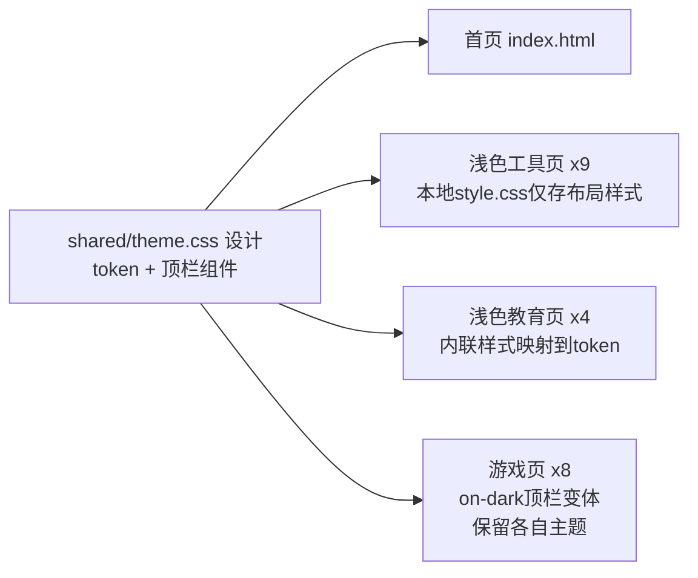

## 产品概述

对纯静态工具站（d:/code/static_tools，首页 + 20 个子工具/游戏页）进行全站 UI 统一重构。用户确认的方案：

1. **统一设计语言，游戏保留主题**：抽出共享 theme.css，统一色板/字体/圆角/组件规范；游戏页保留各自的深色或卡通氛围，但导航、按钮规范、字体与设计语言对齐全站标准。
2. **统一顶栏（品牌 + 返回）**：所有页面顶部统一规格顶栏——左侧品牌名 + 「← 返回首页」链接，右侧显示分类说明；游戏页提供适配其深色/主题氛围的顶栏变体。

## 核心功能

- 新增根级共享样式 `shared/theme.css`，消除 9 个工具页复制粘贴的 `:root` 变量漂移
- 全部 21 个子页面注入统一顶栏（浅色变体 + 深色变体），补齐 18 个缺失的返回首页入口
- 统一字体栈（单一 system 栈）、统一圆角/标题/按钮/间距规范
- 浅色工具页与教育页完全对齐首页 `#f6f8fb / #2563eb` 色板
- 游戏页保留霓虹/卡通/街机主题，仅对齐导航、字体与设计语言
- 验证重构后各页功能无回归、视觉统一

## 技术栈

- 纯 HTML / CSS / 原生 JavaScript，无框架无构建（沿用现状，不引入打包工具）
- 部署：Cloudflare Pages，根目录 `_headers` 已设 `no-cache`，新增 CSS 无需版本参数
- 预览：本地 HTTP 服务器（`restart-server.bat`，端口 8765）；clsf-viewer 使用 ES 模块必须 HTTP 预览

## 实现方案

### 核心策略：token 化 + 分层覆盖

1. **共享设计系统**：新建 `shared/theme.css`，包含：

- `:root` 设计 token（`--bg/--card/--border/--text/--muted/--accent/--accent-soft/--shadow`，沿用首页现有色值 `#f6f8fb / #2563eb`，保证浅色页零视觉迁移）
- 统一字体栈（`-apple-system, "Segoe UI", "PingFang SC", "Microsoft YaHei", sans-serif`）与统一的字号阶梯（h1 24-28px 一档）
- 统一圆角 token：`--radius-sm: 8px / --radius: 12px / --radius-lg: 16px / --radius-pill: 999px`
- 统一顶栏组件 `.site-topbar`：品牌名 + 返回链接（左）+ 分类说明（右），吸顶白卡片样式
- 深色变体 `.site-topbar.on-dark`（或 `body[data-topbar="dark"]`）：半透明深底、浅色文字、发光 hover，供霓虹/科技/卡通游戏页使用
- 通用按钮/卡片基础样式（各页可覆盖）

2. **三类页面的接入深度**：

- **浅色工具页（9 个）**：`<link>` 引入 `shared/theme.css`（置于本地 style.css 之前），删除本地复制的 `:root` 与顶栏旧样式，保留页面特有布局样式；顶栏替换为统一 `.site-topbar`
- **浅色教育页（number-line-animation / number-line-making / five-digit-count / length-scale，内联样式）**：引入 theme.css，将内联 `:root` 变量映射为标准 token，`.back`/`.hero`/`.crumb` 统一替换为 `.site-topbar`
- **游戏页（8 个：maze, pvz, geometry-td, geo-defense, neon-bastion, neon-bastion-op, pink-stack, plant-defense）**：仅引入 theme.css 的顶栏与字体部分（用 `on-dark` 变体），**不动 canvas 渲染、HUD 布局与主题色**；游戏内按钮圆角对齐 `--radius-sm`；plant-defense 的 Trebuchet MS、pink-stack 的 DM Mono 等特例字体仅保留在游戏内容区

3. **首页 index.html**：将内联 token 与 `.head` 标题区改为引用共享 theme.css + 统一顶栏，卡片/标签页样式保留并改为引用 token

### 性能与兼容

- 单个共享 CSS 全站复用（约几 KB），Cloudflare 边缘缓存 + no-cache 校验，无性能负担
- 顶栏为纯 HTML/CSS，无 JS 依赖，不影响各页既有脚本与 localStorage 逻辑
- maze 的 `data-theme` 切换机制保留，顶栏深色变体不与其冲突

### 架构设计



## 目录结构

```
static_tools/
├── shared/
│   └── theme.css                    # [NEW] 共享设计系统：token + 字体栈 + 圆角阶梯 + .site-topbar（浅色/深色变体）+ 基础按钮/卡片
├── index.html                       # [MODIFY] 引入 theme.css，顶栏统一，样式改为引用 token
├── icons-generator/index.html       # [MODIFY] 引入 theme.css，删本地 :root，统一顶栏
├── icons-generator/style.css        # [MODIFY] 移除重复 token 段
├── photo-layout/（index.html + style.css）   # [MODIFY] 同上
├── formatter/（index.html + style.css）      # [MODIFY] 同上
├── clsf-viewer/（index.html + style.css）    # [MODIFY] 同上（注意保持 importmap 与模块加载不动）
├── text-compare/（index.html + style.css）   # [MODIFY] 同上
├── china-holidays/（index.html + style.css） # [MODIFY] 同上
├── clock-learning/（index.html + style.css） # [MODIFY] 同上
├── word-pronunciation/（index.html + style.css）# [MODIFY] 同上
├── length-units/（index.html + style.css）   # [MODIFY] 同上
├── number-line-animation/index.html # [MODIFY] 引入 theme.css，.hero 改统一顶栏，token 映射
├── number-line-making/index.html    # [MODIFY] 同上（删除旧 .back 链接）
├── five-digit-count/index.html      # [MODIFY] 同上（删除旧 .crumb）
├── length-scale/index.html          # [MODIFY] 引入 theme.css，背景对齐标准色板，加顶栏
├── maze/index.html                  # [MODIFY] 加 on-dark 顶栏，字体栈对齐（保留 data-theme 切换）
├── pvz/index.html                   # [MODIFY] 加 on-dark（深木色）顶栏，保留草坪场景
├── geometry-td/index.html           # [MODIFY] 加 on-dark 顶栏替换旧 header，字体对齐
├── geo-defense/index.html           # [MODIFY] 加 on-dark 顶栏（HUD 保留），字体对齐
├── neon-bastion/index.html          # [MODIFY] 加 on-dark 顶栏替换旧品牌栏
├── neon-bastion-op/index.html       # [MODIFY] 同上
├── pink-stack/（index.html + style.css）     # [MODIFY] 旧返回按钮替换为统一顶栏
├── plant-defense/index.html         # [MODIFY] 加顶栏（浅纸色变体），Trebuchet 仅保留在游戏区
└── README.md                        # [MODIFY] 补充共享主题使用说明与新增工具接入规范
```

## 执行要点

- 顶栏 HTML 结构固定：`<header class="site-topbar"><a class="brand" href="../">← Static Tools</a><span class="cat">工具</span></header>`（首页为分类标签页顶栏，游戏页加 `on-dark` 类）
- 修改游戏页时严格只动 head 引入、顶栏节点与全局字体/圆角声明，不触碰 `<script>`、canvas、HUD 与事件逻辑
- 每类页面改完后在本地服务器逐页抽查：顶栏显示、返回链接可达、原功能（出题/导出/游戏开始）不受影响
- 保持 `version-check.js` 引用与 `<meta name="referrer">` 不变

## 设计风格

沿用并强化首页现有的「清爽浅色工具站」风格，扩展为全站设计系统。

### 共享 Token（shared/theme.css）

- 背景 `#f6f8fb`，卡片纯白 + 细边框 `#e6e9ef` + 柔和双层阴影；主色 `#2563eb`（hover `#1d4ed8`），辅助紫 `#7c3aed` 用于图标渐变
- 统一顶栏：白底毛玻璃 + 底部细边框，左侧「← Static Tools」品牌返回链接（accent 色，hover 加深），右侧灰色小字分类标签（工具 / 游戏 / 教育）；游戏页深色变体 `on-dark`：半透明深底 `rgba(10,14,23,.75)` + blur，文字浅色，保留发光 hover
- 统一圆角阶梯：按钮 8px / 卡片 12-16px / 标签 999px 药丸；统一阴影 token
- 统一标题阶梯：页面主标题 24-28px / 区块标题 18px / 正文 14-15px，全部使用单一 system 字体栈

### 各类页面呈现

- 工具/教育页：与首页完全同色板同组件语言
- 游戏页：主题氛围不变（霓虹 mint、科技 cyan/gold、卡通草坪、街机紫粉），仅顶栏、字体与按钮规范对齐

## Agent Extensions

### SubAgent

- **code-explorer**
- Purpose：在执行各批次改造前，精确探查目标页面的 head 结构、顶栏节点、样式来源与依赖（如 clsf-viewer 的 importmap、maze 的 data-theme），确保改动点准确、不破坏功能
- Expected outcome：每个批次改造前获得该页面的确切修改位置清单

### Skill

- **playwright-cli**
- Purpose：重构完成后通过浏览器自动化逐页打开站点（http://localhost:8765），截图验证顶栏统一性、返回链接可用性与各页功能无回归
- Expected outcome：全部页面截图确认视觉统一、控制台无报错、关键交互（游戏开始/工具功能）正常